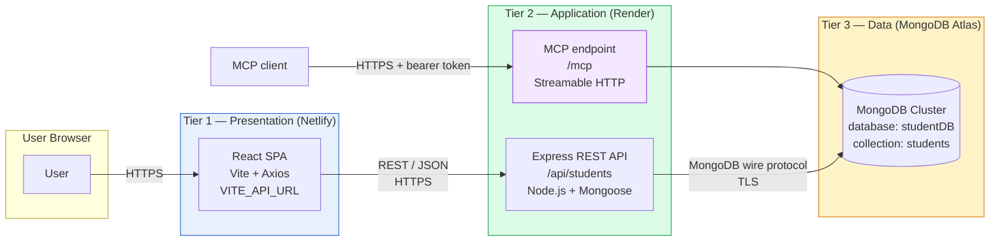

# BIT Student Information Management System

A full-stack **Student Information Management System** built on a **Three-Tier Cloud Architecture**. Manage student records with Create, Read, Update, and Delete (CRUD) operations through a modern, responsive web dashboard.

---

## Table of Contents

1. [Project Description](#1-project-description)
2. [Objectives](#2-objectives)
3. [Three-Tier Architecture](#3-three-tier-architecture)
4. [Architecture Diagram](#4-architecture-diagram)
5. [Technology Stack](#5-technology-stack)
6. [Folder Structure](#6-folder-structure)
7. [Prerequisites](#7-prerequisites)
8. [Local Installation](#8-local-installation)
9. [Environment Variables](#9-environment-variables)
10. [MongoDB Atlas Setup](#10-mongodb-atlas-setup)
11. [API Endpoint Documentation](#11-api-endpoint-documentation)
12. [Render Backend Deployment](#12-render-backend-deployment)
13. [Netlify Frontend Deployment](#13-netlify-frontend-deployment)
14. [Testing Procedure](#14-testing-procedure)
15. [Common Errors and Solutions](#15-common-errors-and-solutions)
16. [Security Notes](#16-security-notes)
17. [Author](#17-author)
18. [MCP Server](#18-mcp-server)

---

## 1. Project Description

This project demonstrates a **three-tier cloud-native application** that separates concerns across presentation, application logic, and data storage. Each tier is deployed independently and communicates with the others exclusively over well-defined interfaces (HTTPS + REST APIs).

Users interact with a React dashboard to:
- Add new student records
- View a searchable, sortable list of all students
- Edit existing records
- Delete records with confirmation
- Receive real-time success/error feedback

The application is intended as a demonstration of modern full-stack cloud deployment practices, suitable for academic submission.

---

## 2. Objectives

- Build a complete CRUD application using a **three-tier architecture**
- Separate frontend, backend, and database into **independently deployable units**
- Demonstrate **REST API** design with proper HTTP status codes and JSON contracts
- Enforce **server-side validation** and centralised error handling
- Manage secrets via **environment variables** — never hard-coded
- Deploy to **free-tier cloud platforms**: Netlify (frontend), Render (backend), MongoDB Atlas (database)
- Practice **Git/GitHub** version control with proper `.gitignore` hygiene

---

## 3. Three-Tier Architecture

| Tier | Layer | Technology | Deployment |
|---|---|---|---|
| **Tier 1 — Presentation** | User interface running in the browser | React 18 + Vite + Axios | **Netlify** |
| **Tier 2 — Application** | REST API server and business logic | Node.js + Express 4 + Mongoose | **Render** |
| **Tier 3 — Data** | Persistent data store | MongoDB Atlas (M0 free cluster) | **MongoDB Cloud** |

**Communication rules:**

- The **frontend never connects directly to MongoDB**. All data access happens through the backend REST API.
- The **backend is stateless** with respect to sessions — every request carries all needed context.
- The **database credentials exist only in the backend environment** on Render. They never appear in frontend bundles or GitHub commits.

---

## 4. Architecture Diagram



## 18. MCP Server

The backend exposes a stateless **Streamable HTTP MCP server** at `POST /mcp`. MCP clients can use these tools:

| Tool | Purpose |
|---|---|
| `list_students` | List all students |
| `get_student` | Read one student by student ID |
| `create_student` | Create a student |
| `update_student` | Update a student by its current student ID |
| `delete_student` | Delete a student by student ID |

### Configure the MCP endpoint

Set `MCP_API_KEY` in the backend environment (local `backend/.env` or your hosting provider). Generate a long random key, for example:

```powershell
node -e "console.log(require('crypto').randomBytes(32).toString('hex'))"
```

The MCP endpoint remains disabled with HTTP 503 until a sufficiently long `MCP_API_KEY` is configured. Requests must include it as a bearer token. Keep the key secret and use HTTPS when connecting remotely.

Configure your MCP client to connect to `https://YOUR_BACKEND_HOST/mcp` using HTTP bearer authentication. Set the bearer token to the value of `MCP_API_KEY`; the exact configuration format varies by client.

The database is accessed only by the backend. The MCP server is independent of the React frontend and uses the existing MongoDB student model.